<div align="center">
  

  <br />

  
  
  

  <p><strong>From product discovery to checkout and store management — one complete, clickable showcase.</strong></p>
  <p>تجربة متجر إلكتروني تفاعلية من DEVPLAY، تعرض رحلة العميل ولوحة الإدارة في موقع واحد.</p>

  <a href="https://devplaystudio.com">DEVPLAY</a> ·
  <a href="https://portfolio.devplaystudio.com">Portfolio</a> ·
  <a href="https://github.com/shahdelbary">GitHub Profile</a>
</div>

---

## ✦ The idea

**NOVA Store** is a front-end commerce demo built to show clients what a modern online shop can feel like. Visitors can browse a curated collection of tech products, build a cart, place a sample order, then switch to a demo admin dashboard to see the same order appear.

The interface is designed in Arabic with right-to-left layout, responsive screens, and a violet/pink visual identity inspired by DEVPLAY.

## ✦ Explore the experience

| Storefront | Checkout | Admin demo |
| :--- | :--- | :--- |
| Search products, filter categories, and view product details. | Change quantities, review totals, and place a sample order. | View orders, update their status, inspect inventory, and hide or show products. |

**Suggested walkthrough:** choose a product → add it to the cart → place a sample order → click **“شاهد الطلب في لوحة الإدارة”** → update its status.

## ✦ What is included

- Six sample products with descriptions, prices, stock, and detail views.
- Search and category filters.
- Cart with quantity controls and live totals.
- Sample checkout with basic form validation and order confirmation.
- Demo dashboard with order overview, status controls, inventory visibility, and illustrative metrics.
- Browser-local persistence with `localStorage` and a reset option.
- Responsive Arabic layout and reduced-motion support.

## ✦ Run locally

Open `index.html` in a browser. No installation, build command, framework, or API key is required.

```text
nova-store-demo/
├── index.html
├── styles.css
├── mobile-fix.css
├── app.js
├── README.md
└── assets/
    └── nova-readme-banner.svg
```

## ✦ Publish with GitHub Pages

1. Create a **separate repository** for this project. Do not replace the special `shahdelbary` profile repository.
2. Upload all files and the `assets` folder to the repository root.
3. Open **Settings → Pages**.
4. Under **Build and deployment**, choose **Deploy from a branch**, then select `main` and `/(root)`.
5. Save and copy the real Pages URL once GitHub shows it. Add that URL to your GitHub profile and portfolio.

## ✦ Demo scope

This is a **showcase**, not a live commerce backend. Products, initial orders, and chart values are illustrative. No real payment is taken. The admin view is intentionally open so clients can explore it; it has no authentication. New orders and changes live only in each visitor's browser, so they are not shared across devices or sent to DEVPLAY.

## ✦ Customize

- Edit sample products, prices, and descriptions near the top of `app.js`.
- Change colors and layout in `styles.css`.
- Update copy and links in `index.html`.

<div align="center">
  <br />
  <sub>Designed and developed by <a href="https://devplaystudio.com">DEVPLAY</a> · © 2026</sub>
</div>
